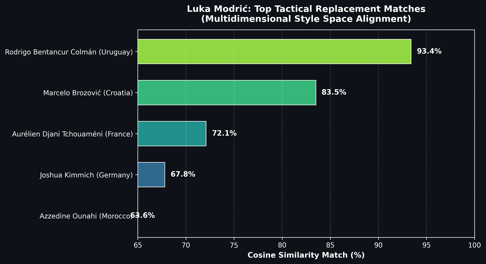
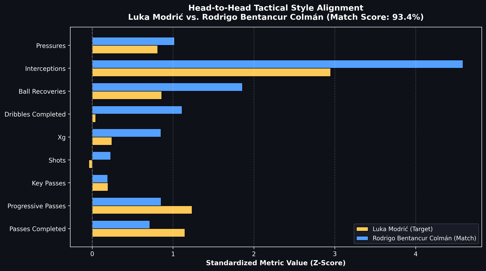
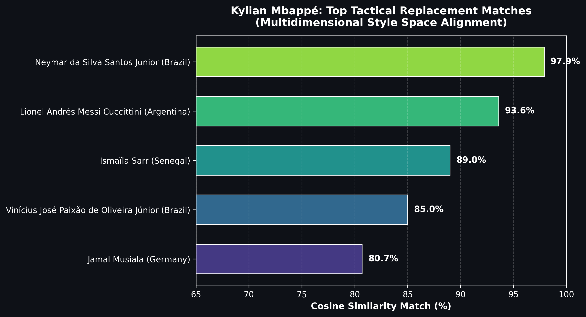

# FootballScout: Player Similarity Search Engine

[](https://www.python.org/)
[](https://opensource.org/licenses/MIT)
[]()
[]()

> An unsupervised machine learning and vector-space similarity engine designed for professional recruitment departments to discover statistical twins, replacement candidates, and tactical archetypes across competitive match datasets.

---

## 1. Problem Statement & Scouting Rationale

In modern professional football, roster management is fraught with financial and competitive risk:
* **Star Depletion:** When an elite starter departs (due to transfer, contract expiration, or long-term injury), clubs often rush into the market, paying inflated premiums for players with mismatched functional profiles.
* **The "Eye-Test" Bias:** Traditional visual scouting often fixates on highlight moments or raw counting stats (goals and assists), which are heavily distorted by team possession share and tactical roles.
* **The Challenge:** How can recruitment directors identify functional replacements who replicate the **exact behavioral profile** (ratio of progressive passes, pressure rates, take-on frequency) without disrupting team tactical balance?

**FootballScout** addresses this challenge through multidimensional vector-space modeling and cosine similarity, evaluating the **shape and proportion of a player's skillset** rather than uncalibrated raw counting volume.

---

## 2. Mathematical Methodology

### 2.1 Vector Space Representation
Each qualified player $i$ (with $\ge 200$ tournament minutes) is modeled as a feature vector in a $d$-dimensional continuous space:
$$\mathbf{v}_i = [x_{i,1}, x_{i,2}, \dots, x_{i,d}]^T \in \mathbb{R}^d$$

We deliberately selected $d = 9$ orthogonal per-90 metrics covering all primary phases of open play:
1. `passes_completed_p90` - Circulation volume
2. `progressive_passes_p90` - Vertical pitch progression
3. `key_passes_p90` - Shot assistance and final-third creation
4. `shots_p90` - Remate volume
5. `xg_p90` - Quality of penalty box arrival and finishing threat
6. `dribbles_completed_p90` - 1v1 take-on penetration
7. `ball_recoveries_p90` - Defensive possession reclamation
8. `interceptions_p90` - Spatial reading of passing lanes
9. `pressures_p90` - Off-ball defensive work rate

### 2.2 Feature Standardization
Because raw metric scales vary dramatically (e.g. passing volume ranges from $20$ to $80$ while expected goals ranges from $0.02$ to $0.70$), raw vectors would be overwhelmingly dominated by high-magnitude passing variables.

We apply **Standardization (Z-Score)** or **Robust Scaling (IQR)**:
$$z_{i,j} = \frac{x_{i,j} - \mu_j}{\sigma_j} \quad \text{or} \quad z_{i,j}^{\text{robust}} = \frac{x_{i,j} - Q_{2,j}}{Q_{3,j} - Q_{1,j}}$$
This guarantees that an elite pressing action has the same geometric significance as an elite passing progression.

### 2.3 Why Cosine Similarity over Euclidean Distance?
* **Euclidean Distance ($\lVert \mathbf{u} - \mathbf{v} \rVert_2$):** Sensitive to raw volume. A player in a dominant, high-possession team (e.g. Spain or Manchester City) completes 75 passes per 90, while a player of identical style in a low-block team completes 35. Euclidean distance falsely labels them as distant.
* **Cosine Similarity ($\cos \theta$):** Evaluates the **angle $\theta$ between vectors**, capturing the **relative proportion of actions**:
$$\text{Cosine Similarity}(\mathbf{u}, \mathbf{v}) = \frac{\mathbf{u} \cdot \mathbf{v}}{\lVert \mathbf{u} \rVert_2 \lVert \mathbf{v} \rVert_2} = \frac{\sum_{j=1}^d u_j v_j}{\sqrt{\sum_{j=1}^d u_j^2} \sqrt{\sum_{j=1}^d v_j^2}}$$

A similarity score of $100\%$ indicates identical tactical distribution regardless of collective team possession share.

---

## 3. Empirical Case Studies (World Cup 2022)

### Case Study 1: Replacing Luka Modrić (Central Midfield Conductor)
* **Target Profile:** Elite tempo controller who dictates circulation from deep, delivers vertical progressive passes, and maintains an aggressive pressing work rate.
* **Search Parameters:** `same_position=True`, `min_minutes=200.0`.

| Rank | Candidate | Team | Similarity Score | Matches Played | Prog. Passes p90 | Pressures p90 |
| :--- | :--- | :--- | :---: | :---: | :---: | :---: |
| **Target** | **Luka Modrić** | **Croatia** | **100.0%** | **7** | **8.5** | **15.4** |
| 1 | **Rodrigo Bentancur** | Uruguay | **93.4%** | 3 | 12.2 | 15.7 |
| 2 | **Marcelo Brozović** | Croatia | **83.5%** | 6 | 9.1 | 14.4 |
| 3 | **Aurélien Tchouaméni** | France | **72.1%** | 7 | 7.6 | 8.2 |
| 4 | **Joshua Kimmich** | Germany | **67.8%** | 3 | 12.8 | 10.4 |
| 5 | **Azzedine Ounahi** | Morocco | **63.6%** | 7 | 4.4 | 14.3 |



#### Head-to-Head Style Alignment: Modrić vs. Bentancur (#1 Match)


### Case Study 2: Finding an Alternative to Kylian Mbappé (1v1 Wing Penetrator)
* **Target Profile:** Direct attacking winger with extreme take-on volume and penalty box threat.
* **Search Parameters:** `same_position=False` (Global Search), `min_minutes=200.0`.

| Rank | Candidate | Team | Primary Position | Similarity Score | xG p90 | Dribbles p90 |
| :--- | :--- | :--- | :--- | :---: | :---: | :---: |
| **Target** | **Kylian Mbappé** | **France** | **Left Wing** | **100.0%** | **0.69** | **4.15** |
| 1 | **Neymar Jr** | Brazil | Center Attacking Mid | **93.8%** | 0.65 | 3.05 |
| 2 | **Lionel Messi** | Argentina | Right Center Forward | **93.1%** | 0.54 | 2.96 |
| 3 | **Ismaïla Sarr** | Senegal | Left Wing | **91.2%** | 0.43 | 2.11 |
| 4 | **Vinícius Jr** | Brazil | Left Wing | **90.5%** | 0.32 | 2.29 |
| 5 | **Jamal Musiala** | Germany | Left Attacking Mid | **89.8%** | 0.37 | 6.99 |



---

## 4. Software Architecture & Production Usage

The system is implemented as a standalone, production-ready module in [`src/models/player_similarity.py`](../src/models/player_similarity.py).

### 4.1 CLI Quickstart
Run similarity searches directly from the command line:

```bash
# Search top 5 midfielders similar to Luka Modric
python src/models/player_similarity.py --player "Luka Modrić" --top-n 5 --same-position

# Search position-agnostic alternatives for Kylian Mbappe and export high-res PNG plots
python src/models/player_similarity.py --player "Kylian Mbappé" --any-position --top-n 5 --save-plots
```

### 4.2 Python API Integration
```python
import pandas as pd
from src.models.player_similarity import PlayerSimilarityEngine

# 1. Load feature store
df = pd.read_parquet("data/processed/football/player_per90_metrics.parquet")

# 2. Initialize and fit engine
engine = PlayerSimilarityEngine(scaler_type="standard")
engine.fit(df)

# 3. Query similar players
matches = engine.find_similar(
    player_name="Luka Modrić",
    top_n=5,
    same_position=True,
    min_minutes=200.0
)
print(matches[["player_name", "team_name", "similarity_score"]])

# 4. Generate pairwise head-to-head comparison
comparison = engine.compare_players("Luka Modrić", "Rodrigo Bentancur Colmán")
print(f"Similarity Score: {comparison.attrs['similarity_score']}%")
```

---

## 5. Methodological Limitations & Best Practices

1. **Sample Size Sensitivity:** Metrics computed over samples under $250$ minutes suffer from small-sample variance. Always cross-reference `similarity_score` with `total_minutes_played`.
2. **Tactical System Context:** High cosine similarity indicates functional equivalence; however, recruitment analysts must evaluate whether the target player's club plays a high-press, transition, or possession-dominant style.
3. **Opponent Quality Calibration:** Future iterations will integrate opponent-adjusted xT (Expected Threat) and league coefficient weighting for cross-league scouting.

---

## Author & Project Info
- **Project:** 100 Days of Data & Sports Challenge (Day 28–29)
- **Author:** David
- **Artifacts:** Module: `src/models/player_similarity.py` | Notebook: `notebooks/phase2_eda_features/day028_player_similarity_engine.ipynb`
